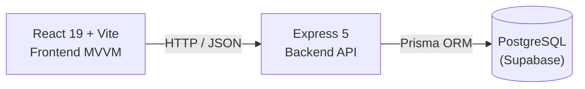

<div align="center">

# SafeAnchor

> Digitalizando gestao de frota, segurança operacional e capacitacao profissional para o setor maritimo.

**MVP de apresentacao — investidores, Parque Tecnologico do Mar banca e parceiros**


</div>

---

Este README e o **Project Control Plane** do SafeAnchor: a fonte principal de
contexto para desenvolvedores e agentes de IA. Ele descreve **o que** o produto
e, **como** esta arquitetado, **o que ja foi implementado** e **o que vem a
seguir**.

> Regra central: nada aqui foi inventado. Todo status foi extraido do estado
> atual do repositorio. Se algo precisa mudar, o repositorio muda primeiro e o
> README depois.

---

## Product Vision

SafeAnchor e uma plataforma **Vertical SaaS** pensada para o ecossistema
maritimo — proprietarios, gestores de frota, prestadores de servicos e marinas.

Se a premissa for correta, **o setor nao precisa so de um app, mas de uma camada
operacional que conecte todo o ecossistema maritimo**.

O projeto nasce no **Parque Tecnologico do Mar (PTM)**, em Caucaia (CE), e nasce
como **MVP de apresentacao**: funcional o suficiente para demonstrar a proposta
de valor e validar a visao com investidores, parceiros e a banca de incubacao.

---

## Problem

### O que o setor ainda usa hoje

- Planilhas e cadernos
- Checklists em papel e inspecoes manuais
- Registro informal de manutencao
- Documentacao descentralizada
- Treinamentos profissionais fragmentados

Esses processos **aumentam riscos operacionais**, **reduzem eficiencia** e
**dificultam a conformidade**.

### O que o SafeAnchor entrega

Uma **camada operacional unificada** que centraliza:

- **Gestao de frotas** — prontidao das embarcacoes em tempo real
- **Manutencao** — agenda, historico, previsao
- **Documentacao** — certificados e conformidade
- **Checklists e inspecoes** — execucao, historico, certificados
- **Treinamento** — trilhas de capacitacao e certificados de conclusao
- **Marketplace** — conexao entre proprietarios, prestadores e marinas
- **Vida a bordo** — registros de viagens e seguranca

---

## Current MVP

O MVP atual segue o **Rebaseline 2026 — Operational Readiness**
([`docs/product/mvp-rebaseline.md`](./docs/product/mvp-rebaseline.md)).

**North Star:**

> O usuario deve entrar no SafeAnchor e entender rapidamente se sua embarcacao
> esta pronta para operar, o que exige atencao e qual e o proximo risco.

**Jornada principal do MVP:**

```
Login → Dashboard → Minha Frota → Embarcacao → Manutencao / Checklists / Documentos → Prontidao Operacional
```

O produto e organizado em torno dessa jornada. Cada feature do rebaseline
contribui para uma etapa dela, do acesso (Login) ate a decisao de prontidao
operacional.

### Demo funcional (26/11/2026)

| Camada | URL |
|---|---|
| App publicada | https://luis-botelho.github.io/safeanchor-monorepo/ |
| API de producao | https://safeanchor-monorepo.vercel.app |
| Saude da API | https://safeanchor-monorepo.vercel.app/health |

O login tem botoes **"Acessos de demonstracao"** que preenchem email e senha
das contas publicas de demonstracao, todas com `role: USER` na API:

| Conta | Senha | Persona |
|---|---|---|
| `demo@safeanchor.app` | `demo123` | `OWNER` |
| `carlos@tecno.boat` | `demo123` | `SERVICE_PROVIDER` |
| `gestao@marinacostaazul.com` | `demo123` | `MARINA` |
| `demo@safeanchor.test` (legado, sem botao) | `demo123456` | `OWNER` |

**Nao ha credencial publica de diretoria.** O acesso a `/director` e
provisionado pelo mantenedor fora do repositorio; veja
[`docs/security-hardening.md`](./docs/security-hardening.md). A persona so define
a navegacao; a autorizacao e por `role` e o isolamento por `Party`. O roteiro
autorizado para apresentacao esta em
[`docs/demo-apresentacao.md`](./docs/demo-apresentacao.md).

**Publicado na rodada final:** area da diretoria em `/director`,
`/director/responses`, `/director/users` e `/director/audit`, protegida por
`roleKey` no frontend e por `authorizeRoles("DIRECTOR","ADMIN")` no backend; a
diretoria analisa respostas da pesquisa, filtra por status/perfil/cidade,
registra decisao/status, altera papel/persona e ve auditoria minima (ator, alvo,
acao, antes/depois e data — nunca senha/token). A pesquisa agora comeca com
"Aceitar captura" ou "Recusar captura": so com aceite ha gravacao no banco e
envio por Resend; com recusa o resumo fica no navegador. Ver
[`docs/seo.md`](./docs/seo.md) para o prerender das rotas publicas.

**Limites da demo:** a API real cobre auth, vessels, maintenances, documents,
inspections, preventive-maintenances, checklist templates/executions, research
com consentimento e as rotas `/director/*`.
Marinas, prestadores, jobs, eventos, viagens, locacoes, marketplace, comunidade,
academy e IA sao catalogos mock/localStorage; o feed de atividades e a
"prontidao" do dashboard tambem sao mock (a API nao expoe `readiness`). O CORS
de producao aceita somente `https://luis-botelho.github.io`; deep links no Pages
respondem `404` com o HTML da SPA (comportamento esperado); o JWT dura 15 min,
fica apenas na memoria da aba e nao ha refresh — ao recarregar, entre novamente. Apresente sempre a producao — o Preview usa um Neon temporario que
expira em `2026-11-29T14:19:24Z`.

---

## MVP Scope

### In Scope

Features definidas no rebaseline 2026 (Features **031–038**):

| Feature | Nome | Situacao |
|---|---|---|
| **031** | Ownership & Access Scope | ✅ backend + escopo aplicado nas rotas core |
| **032** | Product Shell & Main Dashboard | 🔶 shell e dashboard com dados da API; feed de atividades ainda mock |
| **033** | Vessel Operational Profile | 🔶 perfil com dados reais; prontidão calculada no cliente |
| **034** | Documents Core | 🔶 API + cadastro/listagem na UI (sem upload/Storage) |
| **035** | Expiration & Compliance | ✅ status por validade e indicadores no dashboard |
| **036** | Safety Completion & Mobile Polish | 🔶 inspeções via API; checklist desktop, sem mobile/offline |
| **037** | MVP UX Polish | ✅ tema Maritime Precision em produção: skeletons contextuais, estados vazios/erro e spinner nos fluxos core (PR #177 mergeado) |
| **038** | CI/CD & Production Deploy | ✅ PRs #175, #177, #178 e #179 mergeados; Pages e Vercel no ar, `/health` 200, migrations aplicadas, contas demo via API e deploy limpo |

A **Definition of Ready** completa esta em
[`docs/product/mvp-rebaseline.md`](./docs/product/mvp-rebaseline.md): a jornada
Login → Prontidao funciona de ponta a ponta na demo, dados isolados por
ownership, dashboard com dados reais, documentos com vencimentos, execucao de
checklist via API (desktop), UI consistente e backend + frontend publicados com
health check e validacao da demo.

### Out of Scope

Nao fazem parte do MVP atual (definido em
[`docs/product/mvp.md`](./docs/product/mvp.md) e `mvp-rebaseline.md`):

- App mobile nativo e execucao de checklist offline-first
- Integracoes AIS e sensores IoT (previsao preditiva com IA)
- Marketplace completo de prestadores (transacao/pagamento)
- Processamento de pagamentos
- Suporte multi-idioma
- Analytics avancados / dados agregados (Fase 4)
- Assinatura nativa de documentos e workflows de certificacao complexos
- Automacoes de notificacao avancadas (alem de alertas do MVP)
- Maritime Academy (Features 021–025) e QR Code avancado — ficam **pos-MVP**
  conforme rebaseline

Além disso, conforme
[AGENTS.md](./AGENTS.md): **nao adicionar** Next.js, TypeScript ou Tailwind
nesta fase; **preservar** Prisma + PostgreSQL.

---

## Personas

### Personas de produto (modelo de negocio)

| Persona | Papel | Valor pago |
|---|---|---|
| **Proprietario / gestor de frota** | Gerencia embarcacoes, manutencao e documentos | Assinatura mensal (SaaS) |
| **Prestador de servicos** | Recebe chamados, agenda inspecoes, gera certificados | Comissao por servico + planos premium |
| **Marina** | Gerencia ocupacao, equipe, servicos e reservas | Planos de operacao + comissao por intermedio |

### Mecanismos de receita

- **Subscriptions (SaaS)** — planos mensais por persona
- **Transacoes (Marketplace)** — comissao sobre concretizacao de servicos
- **Dados agregados (Analytics)** — relatorios e insights para o setor

### Fases de evolucao

1. **Fase 1 (MVP)** — Proprietarios (frota + manutencao + inspecao)
2. **Fase 2** — Inclusao de prestadores e marketplace
3. **Fase 3** — Marina como operadora central
4. **Fase 4** — dados agregados, analytics e insights

### Roles e personas (estado atual)

O schema define roles **`USER`**, **`MANAGER`**, **`ADMIN`** e **`DIRECTOR`**
(`enum UserRole`; `DIRECTOR` depende da migration `20261127000000_add_director_role`)
e personas **`OWNER`**, **`SERVICE_PROVIDER`** e **`MARINA`** (`enum Persona`).
Escritas em vessels, maintenances, checklists, preventivas, documentos e
inspecoes aceitam `USER`, `MANAGER` e `ADMIN`, sempre limitadas ao escopo do
usuario (`accessScopeService`). As rotas da diretoria exigem `DIRECTOR` ou
`ADMIN`. A persona e retornada em register/login/me, viaja no JWT e define a
navegacao no frontend; a autorizacao real e pelo `role`. As contas demo sao
reais, foram criadas via `/auth/register` na API de producao e aparecem nos
botoes "Acessos de demonstracao" do login.

---

## Core User Journey

Jornada do MVP (rebaseline 2026), de acesso ate a decisao de prontidao:

```
Login → Dashboard → Minha Frota → Embarcacao → Manutencao / Checklists / Documentos → Prontidao Operacional
```

Diagrama completo de acoes por persona: [`docs/user-flow.mmd`](./docs/user-flow.mmd)

Circulacao de dados pelo frontend MVVM, services e backend Prisma:
[`docs/data-flow.mmd`](./docs/data-flow.mmd)

---

## Product Areas

Mapa das areas de produto e seu estado atual no repositorio.

| Area | Descricao | Estado |
|---|---|---|
| **Autenticacao** | Cadastro, login, JWT, persona e roles | ✅ API real + frontend conectado (register, login automatico e botoes de acessos demo) |
| **Diretoria** | Respostas da pesquisa, decisoes, papeis e auditoria | ✅ rotas `/director/*` publicadas, com guard por role |
| **Fleet Management** | CRUD de embarcacoes + prontidao | ✅ API + CRUD na UI; prontidao calculada no cliente |
| **Maintenance** | Agenda, historico, dashboard, preventiva | ✅ API + UI conectadas |
| **Safety Checklists** | Templates + execucoes | ✅ Backend + frontend conectados via API |
| **Inspections** | Agendamento, checklist e certificados | ✅ API + telas de criacao/detalhe conectadas |
| **Documents & Compliance** | Documentos e vencimentos (Features 034/035) | 🔶 API + cadastro/listagem na UI; sem upload/Storage |
| **Dashboard** | Prontidao consolidada da frota | 🔶 dados reais; feed de atividades ainda mock |
| **Marina operations** | Ocupacao, equipe, servicos, reservas, planos | 🔶 Frontend mock apenas |
| **Marine Academy (treinamento)** | Trilhas e certificados | ⬜ Pos-MVP (Features 021–025) |
| **Marketplace / Community / Events** | Conexao entre personas e networking | 🔶 Frontend mock apenas |
| **Vida a bordo (Trips / Boat Rentals)** | Viagens, aluguel, seguranca | 🔶 Frontend mock apenas |

---

## Architecture



Cada lado possui sua propria organizacao interna:

- [`apps/backend/`](./apps/backend/README.md) — API REST em Express
- [`apps/frontend/`](./apps/frontend/README.md) — Interface em React

**Frontend (MVVM):**

```text
PageViews (views/)
    ↓
use*ViewModel hooks (viewmodels/)
    ↓
Services (services/)
    ↓
Mock Data / Backend API
```

**Backend (Route → Controller → Service → Prisma):**

```text
Routes (routes/)
    ↓
Controllers (controllers/)
    ↓
Services (services/)
    ↓
Prisma ORM (lib/prisma.js)
    ↓
PostgreSQL (Supabase)
```

### API — resumo dos endpoints

**Publicos:**

| Metodo | Rota | Descricao |
|---|---|---|
| `GET` | `/` | Status da API |
| `GET` | `/health` | Health check (verifica conexao com o banco) |
| `POST` | `/auth/register` | Cadastro de usuario (aceita `persona`) |
| `POST` | `/auth/login` | Login (retorna JWT com `persona`) |
| `POST` | `/research` | Envio de resposta da pesquisa via Resend; so captura com aceite explicito e versao `2026-11-26` |

**Autenticados:**

| Metodo | Rota | Descricao |
|---|---|---|
| `GET` | `/auth/me` | Dados do usuario autenticado |
| `GET` | `/modules` | Modulos disponiveis |
| `GET` / `POST` | `/vessels` | Lista / cria embarcacoes |
| `GET` | `/vessels/:id` | Detalhe de embarcacao |
| `PUT` / `DELETE` | `/vessels/:id` | Atualiza / remove embarcacao |
| `GET` | `/vessels/:id/maintenances` | Manutencoes da embarcacao |
| `GET` | `/vessels/:id/inspections` | Checklists executados na embarcacao |
| `GET` / `POST` | `/maintenances` | Lista / cria manutencoes |
| `GET` | `/maintenances/dashboard` | Dashboard de manutencao |
| `GET` / `POST` | `/preventive-maintenances` | Agenda preventiva |
| `GET` / `POST` | `/checklist-templates` | Templates de checklist |
| `GET` / `POST` | `/checklist-executions` | Execucoes de checklist |
| `GET` / `POST` | `/documents` | Lista / cria documentos |
| `GET` | `/documents/vessel/:vesselId` | Documentos de uma embarcacao |
| `GET` / `POST` | `/inspections` | Lista / cria inspecoes |
| `GET` | `/inspections/vessel/:vesselId` | Inspecoes de uma embarcacao |
| `GET` | `/inspections/:id` | Detalhe da inspecao |
| `PATCH` | `/inspections/:id/checklist/:itemIndex` | Atualiza item do checklist |
| `POST` | `/inspections/:id/complete` | Conclui inspecao e gera certificado |
| `POST` | `/inspections/:id/cancel` | Cancela inspecao |

**Diretoria (publicado; JWT + `DIRECTOR`/`ADMIN`):**

| Metodo | Rota | Descricao |
|---|---|---|
| `GET` | `/director/responses` | Respostas capturadas, com filtros por status/perfil/cidade |
| `GET` | `/director/insights` | Resumo por status, perfil, cidade e contato |
| `GET` | `/director/users` | Usuarios com papel e persona atuais |
| `GET` | `/director/actions` | Auditoria minima das acoes da diretoria |
| `PATCH` | `/director/users/:id` | Altera papel/persona (registra antes/depois) |
| `PATCH` | `/director/responses/:id` | Registra decisao/status (registra antes/depois) |

Escritas em recursos de dominio aceitam `USER`, `MANAGER` e `ADMIN`, desde que
o recurso pertença ao escopo (owner ou organizacao) do usuario autenticado. As
rotas `/director/*` exigem `DIRECTOR` ou `ADMIN`; o CORS de producao continua
liberando somente `https://luis-botelho.github.io`.

> Documentacao completa nos sub-READMEs: [`apps/backend/README.md`](./apps/backend/README.md) e [`apps/frontend/README.md`](./apps/frontend/README.md).

---

## Tech Stack

| Camada | Tecnologia |
|---|---|
| Frontend | React 19, Vite 7, react-router-dom v7 |
| CSS | BEM em `apps/frontend/src/styles/global.css`, com tokens semânticos (Maritime Precision) |
| Backend | Node.js 22, Express 5, pino (logging) |
| Persistencia | PostgreSQL (Supabase) via Prisma 7 |
| Auth | JWT (bcrypt + jsonwebtoken) |
| Deploy frontend | GitHub Pages (Vite build + SPA fallback) |
| CI/CD | GitHub Actions (backend: generate + validate + test; frontend: build) |

Sem TypeScript, sem Tailwind, sem Next.js — por decisao explícita
([AGENTS.md](./AGENTS.md)).

---

### Sistema visual — Maritime Precision

O tema da pasta `stitch_safeanchor_maritime_ux_architecture/` foi traduzido para
tokens BEM sem novas dependencias e esta em produção desde 26/11/2026 (PR #177):
Light Mist, Deep Ocean Navy, Abyss Teal e Sea Teal, bordas de 1 px, raio 4 px e
numerais tabulares. O contrato de carregamento e movimento esta em
[`docs/visual-system.md`](./docs/visual-system.md):

- **Skeleton** so para layout conhecido (1–10 s), com `aria-busy` e texto
  `.sr-only`; o pulse e finito e opt-in via `prefers-reduced-motion`.
- **Spinner inline** para acoes (submit), nunca skeleton de botao.
- **State view** para erro/vazio, com explicacao e proxima acao.
- `Skeleton`, `PageSkeletons`, `LoadingFallback`, `ErrorState`,
  `SubmitButton` e `InlineSpinner` vivem em `apps/frontend/src/components/`.

---

## Repository Structure

```text
safeanchor-monorepo/
├── apps/
│   ├── backend/
│   │   ├── prisma/
│   │   │   ├── schema.prisma              # schema do banco
│   │   │   ├── migrations/                # 0_init + identidade/ownership + role DIRECTOR e consentimento
│   │   │   └── seed.js                    # seed de desenvolvimento (protegido por flag)
│   │   ├── src/
│   │   │   ├── controllers/               # validacao HTTP
│   │   │   ├── lib/                       # prisma client, logger
│   │   │   ├── middleware/                # auth (JWT), roles
│   │   │   ├── models/                    # queries prisma
│   │   │   ├── routes/                    # rotas REST
│   │   │   ├── services/                  # regras de negocio (incl. accessScope, research e director)
│   │   │   ├── app.js                     # criacao do Express
│   │   │   └── server.js                  # bootstrap
│   │   ├── test/                          # testes (node --test)
│   │   ├── .env.example
│   │   ├── package.json
│   │   └── README.md
│   │
│   └── frontend/
│       ├── public/
│       ├── src/
│       │   ├── components/                # componentes compartilhados
│       │   ├── context/                   # AuthContext (login/cadastro via API)
│       │   ├── mock/                      # dados simulados por modulo
│       │   ├── router/                    # AppRouter + AppShell
│       │   ├── services/                  # camada de dados (mock, API, consentimento e diretoria)
│       │   ├── seo/                       # pageMeta.js: unica fonte de metadados publicos
│       │   ├── styles/                    # BEM CSS global
│       │   ├── viewmodels/                # hooks de logica (MVVM)
│       │   ├── views/                     # paginas (PageViews, incl. /director/*)
│       │   ├── App.jsx
│       │   └── main.jsx
│       ├── scripts/
│       │   ├── prerender.mjs              # HTML estatico, robots.txt e sitemap.xml
│       │   └── generate-brand-assets.mjs  # favicon, manifest e og-image
│       ├── vite.config.js                 # base via VITE_BASE_URL
│       ├── package.json
│       └── README.md
│
├── packages/
│   └── shared/                            # reservado para o futuro (nao usado agora)
│
├── docs/                                  # roadmap, changelog, arquitetura, produto,
│                                          # learning, sprints, retrospectives, releases, deploy
│
├── .github/workflows/
│   ├── ci.yml                             # backend (generate+validate+test), frontend (build)
│   └── deploy-frontend.yml                # GitHub Pages (SPA fallback)
│
├── AGENTS.md                              # regras para agentes de IA
└── README.md
```

---

## Current Implementation Status

> Estado verificado na branch `develop` (a frente de `main`). Nao confie em
> "funcional" sem olhar a tabela — catalogos como marinas, jobs e community
> ainda exibem dados mock.

### Completed

**Backend (API real, PostgreSQL via Prisma):**

- [x] Autenticacao (register/login/me/logout) com **bcrypt (custo 12)** + **JWT** (15 min, `jti`, `iss`/`aud`) e `persona` no payload
- [x] Autorizacao por roles **USER / MANAGER / ADMIN** (`authorizeRoles`); `DIRECTOR` na area da diretoria
- [x] **Ownership & Access Scope** (Feature 031) — `accessScopeService` filtra por party do usuario + organizacoes em todas as rotas core
- [x] CRUD de embarcacoes (listar, criar, detalhe, atualizar, remover)
- [x] Manutencoes + dashboard e manutencao preventiva
- [x] Templates e execucoes de checklist
- [x] Modelos Prisma `Document` e `Inspection` com escopo por embarcacao
- [x] Documents API (listar, por vessel, criar) com validade e indicadores
- [x] Inspections API (criar, listar, detalhe, checklist, concluir com certificado, cancelar)
- [x] Endpoint `/modules` e `/research` (Resend); captura so com consentimento explicito e versao `2026-11-26`
- [x] Area da diretoria: `/director/responses`, `/insights`, `/users`, `/actions` e `PATCH` em usuarios/respostas, com auditoria minima
- [x] Health check com conexao ao banco
- [x] Logging estruturado com pino + redacao de campos sensiveis
- [x] Prisma + PostgreSQL + migrations versionadas (baseline `0_init` registrada)
- [x] Seed de desenvolvimento protegido por `ALLOW_DATABASE_SEED`
- [x] Testes com `node --test`: 37 passando e 3 integracoes puladas sem banco, incluindo controllers/rotas de documentos/inspecoes, `research-consent.test.js`, logout, headers, CSP, rate limit e validacao de entrada

**Frontend (React 19 + Vite, MVVM):**

- [x] Arquitetura MVVM (views → viewmodels → services)
- [x] AppShell com navegacao por persona vinda do usuario autenticado
- [x] Autenticacao real via `/auth/register`, `/auth/login`, `/auth/me` e `/auth/logout` (JWT apenas em memoria da aba, sem persistencia)
- [x] Botoes "Acessos de demonstracao" no login (contas com `role: USER`; nao ha credencial publica de diretoria nem picker de persona)
- [x] Rota `/director` e subrotas com guard por `roleKey`; login da diretoria abre `/director`
- [x] Pesquisa com "Aceitar captura" / "Recusar captura" e escolha revisavel em `/privacidade`
- [x] Cadastro faz register e login automatico (register nao devolve token)
- [x] Services conectados a API: vessels, maintenance, preventive-maintenances, checklists, modules, documents, inspections e dashboard
- [x] Telas reais de cadastro de vessel, manutencao, documento e inspecao; detalhe de inspecao com checklist
- [x] Dashboard calcula prontidao a partir de dados reais da API (manutencoes, documentos, inspecoes e status da embarcacao)
- [x] Estados de loading/empty/error nos fluxos core (skeletons contextuais, `aria-busy` e spinner inline)
- [x] Tema Maritime Precision em tokens BEM, sem Tailwind e sem novas libs
- [x] Prerender estatico de rotas publicas, `noindex` nas privadas e metadados centralizados em `src/seo/pageMeta.js`
- [x] Deploy no GitHub Pages via Actions + fallback SPA `404.html`

**Fundacao (documentacao):**

- [x] Product vision, MVP, business rules, domain model, arquitetura, rebaseline, changelog, learning/retrospectives, SEO (`docs/seo.md`)

### In Progress

Itens do rebaseline ainda incompletos:

- [ ] **034** — upload de arquivos e Supabase Storage (metadados, validade e listagem ja funcionam)
- [ ] **036** — checklist mobile/offline e revalidacao de QR Code

**038 concluida:** Pages e Vercel no ar; `/health` da Vercel responde `200` com
`database: up`, PRs #175 a #181 mergeados em `main`. A area da
diretoria, o consentimento da pesquisa e o SEO estao publicados; a validacao
final fechou 157/157 checks.

### Next

1. Migrations `20261127000000_add_director_role` e
   `20261127000100_add_research_consent_and_director` aplicadas em producao por
   bootstrap temporario removido no mesmo ciclo; nao rodar seed contra producao.
2. Area da diretoria e consentimento da pesquisa publicados em `main` e validados
   com `npm.cmd run verify:demo` (157/157 checks).
3. Apresentar sempre a producao; o Preview usa Neon temporario que expira em `2026-11-29T14:19:24Z`.
4. Upload de documentos (Supabase Storage) e polish mobile do checklist. Ver `docs/handoff-freeze.md`.

### Blocked

- **Novas migrations em producao** — a Vercel nao devolve segredos via CLI; exige `DIRECT_URL` do Supabase fornecida pelo usuario. As migrations antigas e as duas novas estao aplicadas e o banco esta saudavel (`/health` 200, `database: "up"`). Ver `docs/handoff-freeze.md`.
- **Upload de documentos** — depende de Supabase Storage e politicas de acesso.

### Known Limitations (verificadas)

- Catalogos (marinas, prestadores, jobs, community, eventos, trips, academy e IA) ainda usam dados mock.
- O feed de atividades do dashboard ainda e mock.
- Documentos nao tem upload/download de arquivos — a API guarda metadados/URLs.
- A prontidao e calculada no cliente; a API nao expoe endpoint de `readiness`.
- O CORS de producao so aceita `https://luis-botelho.github.io`; um frontend local nao deve apontar para a API publica.
- Deep links no Pages (`/login`, `/pesquisa`, `/privacidade`, `/director/*`) respondem `404` com o HTML da SPA — esperado pelo fallback.
- O JWT dura 15 min e nao ha refresh; se expirar, ou ao recarregar a pagina, faca login novamente.
- Nao ha testes automatizados no frontend e nao ha script de lint.
- Restam 3 vulnerabilidades high transitivas do Prisma 7 (`effect`); corrigi-las exigiria downgrade breaking.

---

## Roadmap

Mapa em blocos sequenciais. O objetivo aqui e mostrar o mapa, nao detalha-lo.

1. **Product / UX** — Rebaseline 2026 validado; jornada Login → Prontidao com telas conectadas. Proximo: upload de documentos e mobile polish.
2. **Frontend** — MVVM pronto; modulos core conectados a API. Proximo: catalogos (marinas/jobs/community) e testes automatizados.
3. **Backend / API** — Nucleo REST pronto (auth, vessels, maintenances, checklists, documents, inspections, modules, research) e rotas `/director/*` publicadas. Pendente: notificacoes, OpenAPI/Swagger, refresh token.
4. **Database** — Prisma + PostgreSQL + migrations e RLS sem policies prontos, com `Document`, `Inspection`, `ResearchResponse` e `DirectorAction`. Migrations novas aplicadas em producao por bootstrap temporario removido no mesmo
ciclo; pendente: politicas de Storage.
5. **Authentication** — JWT (15 min, `jti`, `iss`/`aud`) + bcrypt no backend e login/cadastro reais no frontend. Botoes demo apenas com `role: USER`; sem credencial publica de diretoria. Token em memoria e logout com revogacao. Pendente: refresh token.
6. **Authorization** — Roles + ownership + persona prontos; `DIRECTOR`/`ADMIN` protegem a diretoria no frontend e no backend. Pendente: permissoes por modulo e por organizacao.
7. **Core Maritime Domain** — Frota, manutencao, preventiva, checklists, documentos e inspecoes prontos. Proximo: compliance avancado.
8. **Storage** — Nao iniciado; necessario para upload/download de documentos (Supabase Storage).
9. **Mobile** — Nao iniciado; mobile polish de checklists (Feature 036) e PWA sao itens futuros.
10. **Testing** — Backend com 37 testes passando (incluindo documentos/inspecoes, `research-consent.test.js`, logout, headers, CSP, rate limit e validacao); 3 integracoes puladas sem banco. Faltam testes no frontend.
11. **Security** — Correcoes da auditoria 26/11 aplicadas: rate limit, JWT curto com revogacao, token em memoria, nonce de consentimento, headers/CSP em Report-Only e validacao de entrada. Pendente: upload security, scanner no CI e rotacao de segredos pelo mantenedor.
12. **Observability** — Logging estruturado + health check prontos. Pendente: metricas, tracing e alertas.
13. **Infrastructure** — Frontend no GitHub Pages e API na Vercel, com Supabase saudavel (`/health` 200).
14. **CI/CD** — CI e deploys (Pages + Vercel) prontos; verificacao da demo em `scripts/verify-demo.mjs` e roteiro em `docs/demo-apresentacao.md`.
15. **Production Readiness** — ✅ Feature 038 concluida; demo de apresentacao validada em 26/11/2026.
16. **Pilot / Validation** — Em preparacao; validacao com PTM, parceiros e investidores.

---

## AI Development Workflow

A IA nunca decide sozinha mudancas de escopo. O fluxo e:

```text
Human
  → Analysis
  → Specification
  → AI Implementation
  → Human Review
  → Tests
  → Commit
  → Pull Request
  → Merge
```

A **especificacao** vem do humano (ou de documento aprovado) antes de qualquer
implementacao. Alteracoes de escopo sao propostas pela IA, mas sempre
aprovadas pelo humano.

---

## AI Rules

Regras para agentes de IA que atuarem neste repositorio (tambem em
[AGENTS.md](./AGENTS.md)):

1. Primeiro entender o contexto.
2. Depois analisar.
3. Depois propor plano.
4. So entao implementar.
5. Trabalhar em pequenos incrementos.
6. Nao alterar arquivos fora do escopo.
7. Nao adicionar dependencias sem justificativa.
8. Nao apagar funcionalidades existentes sem autorizacao.
9. Nao considerar uma tarefa concluida sem validacao.
10. Sempre informar arquivos alterados.
11. Sempre informar comandos de validacao executados.
12. Sempre informar limitacoes ou problemas encontrados.

Cuidados de stack nesta fase: nao adicionar Next.js, TypeScript ou Tailwind;
preservar Prisma e PostgreSQL; nunca versionar `.env` ou credenciais do
Supabase; usar `DATABASE_URL` no runtime e `DIRECT_URL` no Prisma CLI.

---

## Definition of Done

Uma tarefa so e considerada concluida quando:

- [x] implementacao realizada;
- [x] testes relevantes executados;
- [x] build validado quando aplicavel;
- [x] comportamento revisado;
- [x] documentacao atualizada quando necessario;
- [x] alteracao revisada pelo humano;
- [x] commit criado.

---

## Development Commands

> Comandos reais extraidos dos `package.json` do repositorio. Nada foi inventado.
> **Nao existe script de lint** (sem ESLint configurado).

### Instalacao

```bash
# raiz — instala frontend e backend
npm run install:all

# ou por app
npm install --prefix apps/backend
npm install --prefix apps/frontend
```

> **Windows (PowerShell):** use `npm.cmd`, `Copy-Item .env.example .env` e
> `$env:VARIAVEL="valor"` (ex.: `$env:ALLOW_DATABASE_SEED="true"`).

### Backend

```bash
cd apps/backend
cp .env.example .env     # preencha DATABASE_URL / DIRECT_URL / JWT_SECRET

npm run dev              # dev com watch (node --watch src/server.js)
npm start                # producao local (node src/server.js)
```

API por padrao em `http://localhost:3001` (define `PORT` no `.env`).

### Frontend

```bash
cd apps/frontend
npm run dev              # Vite dev server
npm run build            # build de producao (dist/)
npm run preview          # previsualiza o build
```

Aplicacao em `http://localhost:5173`.

Build local validado no Windows (dentro de `apps/frontend`):

```powershell
$env:VITE_BASE_URL="/safeanchor-monorepo/"
$env:VITE_API_URL="https://safeanchor-monorepo.vercel.app"
$env:VITE_RESEARCH_WHATSAPP="5524992772357"
npm.cmd run build
```

> Rodar pela raiz (scripts do monorepo): `npm run dev:frontend`,
> `npm run dev:backend`, `npm run start:backend`.

### Testes

```bash
cd apps/backend
npm test                 # node --test (nao toca no Supabase)

ALLOW_DATABASE_SMOKE=true npm run test:db:smoke   # smoke test contra o banco (consultar docs)
```

### Database / Migrations (backend)

```bash
cd apps/backend
npx prisma generate      # gera o client Prisma
npm run prisma:validate  # valida o schema
npm run prisma:status    # status das migrations

# Seed de desenvolvimento — BLOQUEADO por padrao; habilite somente ciente do destino
ALLOW_DATABASE_SEED=true npx prisma db seed

# Comparar schema com o banco antes de registrar baseline (diff vazio)
npx prisma migrate diff --from-config-datasource --to-schema=prisma/schema.prisma --script
```

> Nunca use `prisma migrate reset` ou `prisma db push` no projeto remoto.

### CI (GitHub Actions)

- `ci.yml` — backend: generate + validate + test; frontend: build
- `deploy-frontend.yml` — build com `VITE_BASE_URL=/safeanchor-monorepo/` e deploy no GitHub Pages

---

## Environment

Somente as variaveis realmente utilizadas pelo projeto. **Nenhum secret ou
valor sensivel aqui** — nunca versione `.env`.

### Backend (`apps/backend/.env`)

| Variable | Obrigatoria | Descricao |
|---|---|---|
| `DATABASE_URL` | sim | Conexao de runtime (Supabase pooler) |
| `DIRECT_URL` | sim* | Conexao para Prisma CLI (migrations/generate/validate) |
| `JWT_SECRET` | sim | Assinatura dos tokens JWT e do nonce de pesquisa (minimo 32 caracteres; valor aleatorio) |
| `PORT` | nao | Porta do servidor (padrao `3001`) |
| `FRONTEND_ORIGIN` | sim em prod | Origem liberada no CORS: `https://luis-botelho.github.io` |
| `RESEND_API_KEY` | sim (para `/research`) | Chave da API Resend; nunca usar variavel `VITE_*` |
| `RESEARCH_FROM_EMAIL` | sim (para `/research`) | Remetente verificado no Resend |
| `RESEARCH_INBOX` | nao | Destinatario das respostas (padrao `pesquisa@safeanchor.app`) |

`*` `DIRECT_URL` e obrigatoria para comandos do Prisma CLI; em runtime o backend usa apenas `DATABASE_URL`.

Flags de operacao (avaliacao do proprio contexto):

| Flag | Efeito |
|---|---|
| `ALLOW_DATABASE_SEED` | Libera a execucao do seed (somente banco local) |
| `ALLOW_DATABASE_SMOKE` | Libera o smoke test contra o banco |

> Em producao nao rodar migrations nem `prisma db seed` sem `DIRECT_URL`
> operacional, nao reintroduzir `/__setup` ou `SETUP_TOKEN` e nunca versionar
> `.env`. As contas demo foram criadas pela propria API.

### Frontend

| Variable | Obrigatoria | Descricao |
|---|---|---|
| `VITE_API_URL` | sim | URL da API (`http://localhost:3001` no exemplo; URL publica da Vercel em producao) |
| `VITE_BASE_URL` | sim (GH Pages) | Base do build; no CI e `/safeanchor-monorepo/` |
| `VITE_RESEARCH_WHATSAPP` | nao | Numero (55 + DDD) do botao flutuante de contato e do link da pesquisa |
| `VITE_RESEARCH_INBOX` | nao | Destino sugerido no link manual de e-mail |

> Na raiz nao ha `.env`; o `apps/frontend/.env.example` esta versionado.

> **Privacidade e contato na demo:** a SPA publica a rota publica `/privacidade`
> (politica LGPD), mostra um aviso de armazenamento local com aceite registrado
> em `safeanchor.cookieConsent` e exibe um botao flutuante de WhatsApp quando
> `VITE_RESEARCH_WHATSAPP` e configurado no build. O formulario `/pesquisa`
> comeca com "Aceitar captura" ou "Recusar captura": com aceite (versao
> `2026-11-26`) respostas, perfil e contato opcional sao enviados a `/research`,
> gravados em `ResearchResponse` e encaminhados por Resend; com recusa nada e
> enviado ao servidor e o resumo fica so no navegador. A escolha pode ser
> alterada/revogada em `/privacidade`. `safeanchor.researchConsent` guarda
> decisao, versao e data. Nao ha cookies de rastreamento, analytics ou
> publicidade; WhatsApp continua link manual `wa.me`. O envio por e-mail foi
> validado em 26/11/2026 (resposta `202` e recebimento confirmado).

---

## Security Baseline

Principios de seguranca do MVP — marcados pelos que **ja existem** no repositorio.

| Tema | Situacao |
|---|---|
| Authentication | ✅ JWT + bcrypt (custo 12), expiracao 15 min; token apenas em memoria no frontend |
| Authorization | ✅ Roles `USER`/`MANAGER`/`ADMIN` e persona no backend; `DIRECTOR`/`ADMIN` nas rotas da diretoria |
| Ownership / Access Scope | ✅ `accessScopeService` isola vessels, documents e inspections por party/organizacao |
| Password hashing | ✅ bcrypt; hash nunca exposto |
| JWT security | ✅ payload com `userId`, `partyId`, `role`, `persona` e `jti`; `iss`/`aud`, HS256, secret minimo 32 caracteres e logout com revogacao |
| Input validation | ✅ validacoes nos controllers, incluindo documentos e inspecoes |
| Rate limiting | ✅ auth por IP/e-mail e `/research` por IP, com honeypot |
| Secure secrets | ✅ `.env*` ignorado; apenas `.env.example` versionado |
| Database security | ✅ RLS ativo sem policies; privilegios de `anon`/`authenticated` revogados; acesso so via backend |
| Upload security | ⬜ depende de Supabase Storage (ainda nao implementado) |
| Logging | ✅ pino estruturado com redacao de headers/body sensiveis |
| Backups | 🔶 via Supabase (gerenciado; fora do codigo) |
| Dependency / security scanning | ✅ `npm audit`: frontend 0 e backend 0 após fixar `effect@3.22.5`; CI falha em alertas `high` e roda `verify:local` |

---

## Product Decision Log

Decisoes ja tomadas. Datas aproximadas pelo historico do git.

| Date | Decision | Reason |
| ---- | -------- | ------ |
| 2026 | Monorepo com `apps/backend` + `apps/frontend` | Separar API e UI mantendo repo unico de estudo |
| 2026 | Frontend em MVVM; backend em Route → Controller → Service → Prisma | Camadas testaveis e didaticas |
| 2026 | Prisma 7 + PostgreSQL (Supabase) | ORM com types/safety e migrations; banco gerenciado |
| 2026 | `DATABASE_URL` no runtime, `DIRECT_URL` no Prisma CLI | Pooling no runtime, conexao direta para migrations |
| 2026 | JWT sem refresh token no MVP | Simplicidade; refresh sera adicionado na fase de producao |
| 2026 | RLS habilitado sem policies; acesso so pelo backend | Bloquear Data API e manter um unico caminho de acesso |
| 2026 | Datas como `String` e `items`/`responses` como JSON nos contratos atuais | Preservar contratos da API existente |
| 2026 | `packages/shared` reservado, sem uso agora | Aprender com estrutura simples antes de abstrair |
| 2026 | GitHub Pages com fallback `404.html` | Roteamento SPA em subpath |
| 2026 | Seed e operacoes destrutivas protegidas por flags | Evitar alteracoes acidentais no banco remoto |
| 2026-09 | Rebaseline do MVP: Operational Readiness (Features 031–038) | Focar na jornada Login → Prontidao Operacional |
| 2026 | Sem Next.js / TypeScript / Tailwind nesta fase | Fase de aprendizado, stack simples e didatica |
| 2026-11 | Tema Maritime Precision traduzido para tokens BEM | Referencia visual do usuario sem introduzir Tailwind ou libs de animacao |
| 2026-11 | Skeleton so para layout conhecido; acoes usam spinner inline | Evita piscar, salto visual e movimento que infringe WCAG 2.2.2 |
| 2026-11 | Consentimento explicito e versionado na pesquisa (`2026-11-26`) | Sem captura sem aceite; diretoria so analisa respostas autorizadas |
| 2026-11 | Diretoria autorizada por `role`, nao por persona | Persona e navegacao; `DIRECTOR`/`ADMIN` protegem rotas e API |
| 2026-11 | Prerender estatico em vez de SSR | GitHub Pages serve arquivos; SPA permanece MVVM e sem Next.js |

---

## Current Focus

> **O que estamos tentando resolver AGORA?**

Apresentar o **MVP de apresentacao (Rebaseline 2026 — Operational Readiness)**:
a jornada **Login → Dashboard → Frota → Embarcacao →
Manutencao/Checklists/Documentos → Prontidao Operacional** ja esta publicada com
dados reais e ownership aplicado de ponta a ponta, pronta para validacao com
investidores, parceiros e PTM. A pesquisa tem consentimento explicito e a diretoria tem area propria para
decidir e auditar; tudo publicado em `main`.

---

## Next Action

> **Next Action**

**Demo publicada e validada:** os PRs #175 a #181 (`develop` → `main`) foram
mergeados; o ciclo final removeu o bootstrap temporário e sincronizou a
documentação. O frontend roda no GitHub Pages, a API na Vercel com `/health`
`200`, as migrations aplicadas e as contas demo publicas criadas via
`/auth/register`. O tema Maritime Precision, a área da diretoria, o
consentimento e o SEO estão em produção desde 26/11/2026 — validação final com
**157/157 checks**. A rodada de endurecimento posterior corrigiu os achados da
auditoria de 26/11; detalhes e ações externas pendentes em
`docs/security-hardening.md`. Para novas mudanças, trabalhe em `develop` e abra PR:
**nao fazer merge direto em `main`**. Antes de apresentar,
leia `docs/demo-apresentacao.md` (roteiro e verificacao via
`node scripts/verify-demo.mjs`); antes de mexer, leia `docs/handoff-freeze.md`,
`docs/diagnostico.md`, `docs/visual-system.md` e `docs/seo.md`.

---

<div align="center">

Desenvolvido por **Luis Botelho** · [GitHub](https://github.com/luis-botelho) · [LinkedIn](https://linkedin.com/in/luis-botelho)

</div>