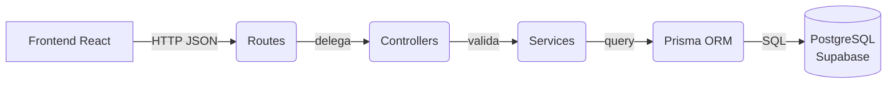

<div align="center">

# SafeAnchor — Backend

**API REST em Express 5 para o MVP de apresentacao do SafeAnchor**


</div>

---

## Sobre

API responsavel pela persistencia, autenticacao e regras de negocio do SafeAnchor.
Recebe requisicoes REST do frontend (React), aplica validacoes, autenticacao JWT
e persiste os dados em PostgreSQL via Prisma ORM.

> Este README documenta **o que**, **como** e **por que**. As decisoes tecnicas ficam
> registradas para a fase oral — nao so "funciona", mas "funciona e eu sei explicar".

## Sumario

- [Arquitetura](#arquitetura)
- [Stack](#stack)
- [Estrutura de pastas](#estrutura-de-pastas)
- [Como rodar](#como-rodar)
- [Contas de demonstracao](#contas-de-demonstracao)
- [Endpoints](#endpoints)
- [Regras de negocio](#regras-de-negocio)
- [Decisoes tecnicas](#decisoes-tecnicas)
- [Testes](#testes)
- [Roadmap](#roadmap)

---

## Arquitetura

O backend utiliza **arquitetura em camadas com separacao de responsabilidades**.



| Camada | Responsabilidade |
|---|---|
| `routes/` | Declaracao de endpoints e metodo HTTP |
| `controllers/` | Validacao de payload e formato da resposta HTTP |
| `services/` | Regras de negocio e orquestracao |
| `models/` | Queries estruturadas ao Prisma |
| `lib/prisma.js` | Inicializacao do client Prisma |
| `middleware/` | Autenticacao JWT e controle por roles |

---

## Stack

- **Node.js 22** (exigido pelo `engines` e pelo CI)
- **Express 5** — framework HTTP
- **Prisma 7** — ORM com type-safety e migracoes declarativas
- **PostgreSQL** (Supabase) — banco de dados gerenciado
- **bcrypt** — hashing de senhas
- **jsonwebtoken** — autenticacao JWT
- **pino + pino-http** — logging estruturado

---

## Estrutura de pastas

```text
apps/backend/
├── prisma/
│   ├── schema.prisma                  # schema do banco: modelos + enums
│   └── migrations/                    # inclui role DIRECTOR, ResearchResponse e DirectorAction
├── src/
│   ├── controllers/
│   │   ├── authController.js          # cadastro, login, /auth/me e logout
│   │   ├── vesselController.js        # embarcacoes
│   │   ├── maintenanceController.js   # manutencoes
│   │   ├── preventiveMaintenanceController.js
│   │   ├── checklistTemplateController.js
│   │   ├── checklistExecutionController.js
│   │   ├── documentController.js      # documentos e vencimentos
│   │   ├── inspectionController.js    # inspecoes, checklist e certificado
│   │   ├── researchController.js      # pesquisa via Resend, com consentimento
│   │   ├── directorController.js      # respostas, usuarios e auditoria da diretoria
│   │   └── healthController.js        # health check
│   ├── lib/
│   │   ├── prisma.js                  # cliente Prisma (singleton)
│   │   ├── logger.js                  # pino logger
│   │   ├── jwtConfig.js               # secret (min. 32), issuer/audience
│   │   ├── researchConsent.js         # nonce assinado do consentimento
│   │   └── validation.js              # validacao simples de payloads
│   ├── middleware/
│   │   ├── authMiddleware.js          # requireAuth (JWT)
│   │   ├── authorizeRoles.js          # controle por role (USER/MANAGER/ADMIN/DIRECTOR)
│   │   └── rateLimits.js              # limites por IP/e-mail
│   ├── models/
│   │   ├── vesselModel.js
│   │   ├── maintenanceModel.js
│   │   ├── preventiveMaintenanceModel.js
│   │   ├── checklistTemplateModel.js
│   │   └── checklistExecutionModel.js
│   ├── routes/
│   │   ├── authRoutes.js
│   │   ├── researchRoutes.js
│   │   ├── directorRoutes.js          # /director/* (DIRECTOR ou ADMIN)
│   │   ├── vesselRoutes.js
│   │   ├── maintenanceRoutes.js
│   │   ├── preventiveMaintenanceRoutes.js
│   │   ├── checklistTemplateRoutes.js
│   │   ├── checklistExecutionRoutes.js
│   │   ├── documentRoutes.js
│   │   └── inspectionRoutes.js
│   ├── services/
│   │   ├── authService.js             # hashing, JWT, validacoes
│   │   ├── tokenRevocation.js         # revogacao de jti em memoria
│   │   ├── accessScopeService.js      # controle de acesso por ownership
│   │   ├── vesselService.js
│   │   ├── maintenanceService.js
│   │   ├── maintenanceDashboardService.js
│   │   ├── preventiveMaintenanceService.js
│   │   ├── checklistTemplateService.js
│   │   ├── checklistExecutionService.js
│   │   ├── documentService.js
│   │   ├── inspectionService.js
│   │   ├── researchService.js         # consentimento versionado + Resend
│   │   ├── directorService.js         # decisoes, papeis e auditoria minima
│   │   └── modulesService.js
│   ├── app.js                         # criacao do Express, middlewares, rotas
│   └── server.js                      # bootstrap e start do servidor
├── test/
│   ├── authMiddleware.test.js
│   ├── auth-logout.routes.test.js     # revogacao via POST /auth/logout
│   ├── authorization.integration.test.js
│   ├── database.smoke.test.js
│   ├── documents.inspections.test.js
│   ├── documents.inspections.routes.test.js
│   ├── input-validation.test.js       # payloads invalidos retornam 400
│   ├── observability.test.js
│   ├── ownership-scope.integration.test.js
│   ├── rate-limit.test.js             # limites de auth e /research
│   ├── research-consent.test.js       # consentimento, nonce e diretoria
│   └── security-headers.test.js       # helmet e X-Powered-By
├── .env.example
├── package.json
└── README.md
```

---

## Como rodar

```bash
cd apps/backend
npm install
cp .env.example .env     # preencha DATABASE_URL e DIRECT_URL do Supabase
npx prisma generate
npm run dev
```

API sobe em:

```text
http://localhost:3001
```

## Deploy da API na Vercel

O backend exporta a aplicação Express em `src/server.js`, que a Vercel pode
executar como função Node. Crie um projeto Vercel ligado ao mesmo repositório e
defina **Root Directory** como `apps/backend`. Mantenha a instalação padrão com
`npm install`/`npm ci`; o `postinstall` do projeto gera o cliente Prisma.

Configure estas variáveis no projeto Vercel, em **Settings → Environment
Variables**:

- `DATABASE_URL`: URL de runtime do pooler Supabase.
- `DIRECT_URL`: URL direta ou de sessão necessária pela configuração do Prisma
  durante a geração do cliente.
- `JWT_SECRET`: segredo aleatório com no mínimo 32 caracteres (assina JWT e nonce de pesquisa).
- `FRONTEND_ORIGIN`: `https://luis-botelho.github.io`.
- `RESEND_API_KEY`: chave secreta do Resend. Nunca use uma variável `VITE_*`.
- `RESEARCH_FROM_EMAIL`: remetente verificado no Resend, por exemplo
  `SafeAnchor <pesquisa@safeanchor.app>`.
- `RESEARCH_INBOX`: destinatário das respostas; por padrão
  `pesquisa@safeanchor.app`.

Depois do deploy, confira `/health` na URL atribuída pela Vercel; ela deve
retornar `status: "ok"` e `database: "up"`. A rota pública `POST /research` já
encaminha o resumo pelo Resend. O domínio de `RESEARCH_FROM_EMAIL` precisa estar
verificado na conta Resend. A API e o frontend no GitHub Pages são projetos
separados; configure a URL pública da API como variável `VITE_API_URL` no GitHub
Actions (Settings → Secrets and variables → Actions → Variables).

> **Estado atual da implantação:** a SPA está no GitHub Pages
> (`https://luis-botelho.github.io/safeanchor-monorepo/`) e a API responde em
> `https://safeanchor-monorepo.vercel.app` com `/health` `200` e
> `database: "up"`. Os PRs #175, #177, #178 e #179 foram mergeados em `main`:
> documentos, inspeções e o tema Maritime Precision já estão em produção, com
> migrations aplicadas e deploy limpo (sem endpoint temporário). As contas e os
> dados demo foram criados pela própria API, não por `prisma db seed` em
> produção. O `postinstall` executa `prisma generate`, que exige `DIRECT_URL`
> também nos deployments de Preview — sem essa variável o build falha antes de
> iniciar.
>
> **Banco do Preview:** os deployments de Preview usam um Postgres temporário
> configurado em `DATABASE_URL`/`DIRECT_URL` no ambiente de Preview da Vercel;
> ele expira em `2026-11-29T14:19:24Z`. Apresente sempre a produção. A produção
> continua usando o Supabase configurado no projeto Vercel.
>
> **Produção validada:** `https://safeanchor-monorepo.vercel.app` responde
> `200` em `/health`, login demo e nas listagens, com CORS restrito à origem
> `https://luis-botelho.github.io`. As migrations de `persona`, campos de perfil
> da embarcação e tabelas de documentos/inspeções já estão aplicadas no
> Supabase. O endpoint temporário `/__setup` e a variável `SETUP_TOKEN` foram
> removidos e não devem ser reintroduzidos. O JWT dura 15 min, tem `jti`,
> `iss`/`aud` e pode ser revogado por `/auth/logout`; não há refresh. Deep links
> no Pages respondem `404` com o HTML da SPA (esperado). Para novas
> migrations, a Vercel não devolve segredos via CLI: é necessário fornecer
> `DIRECT_URL` com acesso ao banco (ver
> [`../../docs/handoff-freeze.md`](../../docs/handoff-freeze.md)). Não rode
> migrations nem `prisma db seed` contra a produção sem essa providência
> explícita.
>
> **Aplicadas em produção:** as migrations
> `20261127000000_add_director_role` (`UserRole.DIRECTOR`) e
> `20261127000100_add_research_consent_and_director` (tabelas
> `ResearchResponse`/`DirectorAction`) foram executadas por bootstrap temporário,
> removido junto com a variável `BOOTSTRAP_DIRECTOR_SCHEMA`. A promoção de
> diretoria foi retirada da migration: a conta antiga precisa ser rotacionada e
> invalidação de sessões pelo mantenedor. Veja
> `../../docs/security-hardening.md`.

## Contas de demonstracao

As contas abaixo existem de verdade na API de producao e foram criadas por
`/auth/register` (nao por seed). O login do frontend tem botoes **"Acessos de
demonstracao"** que preenchem e-mail e senha das quatro principais.

| Conta | Senha | Persona | Role na API |
|---|---|---|---|
| `demo@safeanchor.app` | `demo123` | `OWNER` | `USER` |
| `carlos@tecno.boat` | `demo123` | `SERVICE_PROVIDER` | `USER` |
| `gestao@marinacostaazul.com` | `demo123` | `MARINA` | `USER` |
| `demo@safeanchor.test` (legado, sem botao) | `demo123456` | `OWNER` | `USER` |

Todas as contas publicas sao `USER`. `persona` e metadado de navegacao; a
autorizacao e por `role` (`authorizeRoles`) e o isolamento por `Party`
(`accessScopeService`). Nao ha conta publica de `DIRECTOR`: as rotas
`/director/*` exigem credencial provisionada fora do repositorio.

Dados demo em producao (via API, nao via seed): `demo@safeanchor.app` e
`demo@safeanchor.test` tem 3 vessels, 5 maintenances, 5 documents,
4 inspections (1 concluida com certificado), 1 preventive e 1 checklist
execution; `carlos@tecno.boat` e `gestao@marinacostaazul.com` tem 2 vessels,
2 maintenances, 2 documents, 1 inspection concluida, 1 preventive e 1 execution.
Existe um template global "Checklist de segurança — demo". A API cobre auth,
vessels, maintenances, documents, inspections, preventive-maintenances,
checklist templates/executions e research; marinas, prestadores, jobs, eventos,
viagens, locacoes, marketplace, comunidade, academy e IA sao catalogos mock no
frontend, assim como o feed e a "prontidao" do dashboard.

<details>
<summary><strong>Testando rapidamente com curl</strong></summary>

```bash
# healthcheck
curl http://localhost:3001/health

# cadastro
curl -X POST http://localhost:3001/auth/register \
  -H "Content-Type: application/json" \
  -d '{"name":"Maria","email":"maria@test.com","password":"123456","persona":"OWNER"}'

# login
curl -X POST http://localhost:3001/auth/login \
  -H "Content-Type: application/json" \
  -d '{"email":"maria@test.com","password":"123456"}'

# listar embarcacoes (com token JWT)
curl http://localhost:3001/vessels \
  -H "Authorization: Bearer <token>"
```

</details>

---

## Endpoints

### Publicos (sem autenticacao)

| Metodo | Rota | Descricao |
|---|---|---|
| `GET` | `/` | Status da API |
| `GET` | `/health` | Health check (verifica conexao com o banco) |
| `POST` | `/auth/register` | Cadastro de novo usuario (nome, e-mail valido e senha com 12+ caracteres) |
| `POST` | `/auth/login` | Login — retorna JWT com `jti`, `iss`/`aud` e 15 min de validade |
| `GET` | `/research/nonce` | Emite nonce assinado, com validade de 10 min, para o aceite |
| `POST` | `/research` | Envia uma resposta da pesquisa pelo Resend; so grava e envia com nonce valido e versao `2026-11-26` |
| `POST` | `/api/csp-report` | Recebe violações de CSP do frontend (limitado por IP; campos saneados antes do log) |

### Autenticados (requer `Authorization: Bearer <token>`)

| Metodo | Rota | Descricao |
|---|---|---|
| `GET` | `/auth/me` | Dados do usuario autenticado (inclui `persona`) |
| `POST` | `/auth/logout` | Revoga o token atual (`jti`) |
| `GET` | `/modules` | Modulos disponiveis |
| `GET` | `/vessels` | Lista embarcacoes do escopo do usuario |
| `POST` | `/vessels` | Cria embarcacao |
| `GET` | `/vessels/:id` | Detalhe da embarcacao |
| `PUT` | `/vessels/:id` | Atualiza embarcacao |
| `DELETE` | `/vessels/:id` | Remove embarcacao |
| `GET` | `/vessels/:id/maintenances` | Manutencoes da embarcacao |
| `GET` | `/vessels/:id/inspections` | Execucoes de checklist da embarcacao |
| `GET` | `/maintenances` | Lista manutencoes |
| `POST` | `/maintenances` | Cria manutencao |
| `GET` | `/maintenances/dashboard` | Dashboard de manutencao |
| `GET` | `/preventive-maintenances` | Lista agenda preventiva |
| `POST` | `/preventive-maintenances` | Cria item preventivo |
| `GET` | `/checklist-templates` | Lista templates de checklist |
| `POST` | `/checklist-templates` | Cria template |
| `GET` | `/checklist-executions` | Lista execucoes de checklist |
| `POST` | `/checklist-executions` | Registra execucao |
| `GET` | `/documents` | Lista documentos do escopo |
| `GET` | `/documents/vessel/:vesselId` | Documentos de uma embarcacao |
| `POST` | `/documents` | Cria documento (metadados e validade) |
| `GET` | `/inspections` | Lista inspecoes do escopo |
| `GET` | `/inspections/vessel/:vesselId` | Inspecoes de uma embarcacao |
| `GET` | `/inspections/:id` | Detalhe da inspecao |
| `POST` | `/inspections` | Cria inspecao com checklist |
| `PATCH` | `/inspections/:id/checklist/:itemIndex` | Atualiza item do checklist |
| `POST` | `/inspections/:id/complete` | Conclui e gera certificado |
| `POST` | `/inspections/:id/cancel` | Cancela inspecao |

**Diretoria (publicado; JWT + `authorizeRoles("DIRECTOR","ADMIN")`):**

| Metodo | Rota | Descricao |
|---|---|---|
| `GET` | `/director/responses` | Lista respostas capturadas; filtros `status`, `profile`, `city`, `from`, `to` e `limit` |
| `GET` | `/director/insights` | Resumo por status/perfil/cidade, total, contato e ultimos 7 dias |
| `GET` | `/director/users` | Usuarios com `id`, `name`, `email`, `role` e `persona` |
| `GET` | `/director/actions` | Auditoria minima (ator, alvo, acao, antes/depois e data) |
| `PATCH` | `/director/users/:id` | Altera nome/papel/persona; nao permite alterar o proprio papel nem remover o ultimo diretor |
| `PATCH` | `/director/responses/:id` | Registra `status` (`NEW`/`REVIEWED`/`ACTIONED`) e `decision` |

Escritas em `vessels`, `maintenances`, `preventive-maintenances`,
`checklist-templates`, `checklist-executions`, `documents` e `inspections`
exigem `USER`, `MANAGER` ou `ADMIN`, com escopo aplicado pelo
`accessScopeService`. As rotas `/director/*` exigem `DIRECTOR` ou `ADMIN`; o CORS
continua liberando somente `https://luis-botelho.github.io`.

---

## Regras de negocio

### Autenticacao

- Senhas sao armazenadas com **bcrypt** (custo 12).
- `/auth/register` aceita `persona` (`OWNER`, `SERVICE_PROVIDER` ou `MARINA`), cria
  o `Party`/`User` e retorna o usuario — sem token.
- O login retorna um **JWT** (15 min) com `userId`, `partyId`, `role`, `persona`,
  `jti`, `iss` e `aud`; a verificacao usa HS256 explicitamente.
- `/auth/me` exige token, reconsulta o `role` no banco e devolve o perfil;
  `/auth/logout` revoga o `jti` da requisicao. Register e login sao publicos.
- O frontend guarda o token apenas em memoria e faz register+login em sequencia
  para obter a sessao. Tokens antigos, sem `iss`/`aud`/`jti`, deixam de ser aceitos.

### Ownership (controle de acesso)

O `accessScopeService` garante que um usuario so acesse seus proprios dados:
embarcacoes, manutencoes, documentos, inspecoes e execucoes de checklist sao
filtrados pelo `partyId` do usuario e pelas organizacoes das quais ele e membro.
`ADMIN` enxerga o escopo completo.

### Roles e personas

- `UserRole`: `USER`, `MANAGER`, `ADMIN` e `DIRECTOR` — usados
  pelo `authorizeRoles`; a diretoria e `ADMIN` acessam `/director/*`.
- `Persona`: `OWNER`, `SERVICE_PROVIDER` e `MARINA` — perfil de negocio, exposto
  em register/login/me e no JWT; define a navegacao no frontend, nunca a
  autorizacao. **Nao ha credencial publica de diretoria**: a conta `DIRECTOR`
  e provisionada pelo mantenedor fora do repositorio.
- Escritas nos recursos core aceitam `USER`, `MANAGER` e `ADMIN`.

### Pesquisa com consentimento

- A versao atual do aceite e `2026-11-26` (`RESEARCH_CONSENT_VERSION`, tambem no
  frontend em `src/services/researchConsent.js`).
- `GET /research/nonce` emite um nonce assinado com 10 min de validade.
  `POST /research` so persiste em `ResearchResponse` e envia pelo Resend quando
  `consent.accepted === true` e o nonce e valido para a versao `2026-11-26`.
  Respostas, perfil e contato opcional ficam no banco para analise da diretoria.
- O registro do aceite inclui IP, user-agent e timestamp gerados no servidor,
  versao da politica e `jti` do nonce, em `DirectorAction` (auditoria minima).
- Sem aceite, o servidor nao grava nem envia nada; o resumo permanece apenas no
  navegador e pode ser compartilhado manualmente pelo usuario (WhatsApp/e-mail).
  Links de compartilhamento omitem contato por padrao; a inclusao e explicita.
- A escolha pode ser alterada/revogada em `/privacidade`. Nao ha cookies de
  rastreamento, analytics ou publicidade.

### Diretoria e auditoria

- `GET /director/responses` filtra por `status`, `profile` e `city` (além de
  periodo e limite); `GET /director/insights` resume os capturados.
- `PATCH /director/users/:id` altera papel/persona; `PATCH
  /director/responses/:id` registra decisao e status da analise.
- Toda alteracao gera um `DirectorAction` com ator, alvo, acao e antes/depois.
  A auditoria nunca registra senha ou token.

### Documentos e inspecoes

- Um documento exige `vesselId`, `name`, `category`, `number`, `validFrom` e
  `expiresAt`; `provider` e opcional. A embarcacao precisa pertencer ao escopo.
- Status de validade (`valido`, `proximo`, `vencido`) e calculado no frontend a
  partir de `expiresAt`.
- Uma inspecao exige `vesselId`, `type`, `scheduledAt` e `inspector`; o checklist
  e salvo como JSON.
- A conclusao exige todos os itens revisados (`status !== "pending"`) e gera
  certificado com validade de 6 meses quando nao ha falhas. Com falhas, a API
  conclui sem certificado e o frontend bloqueia a acao.

### Validacoes

- Emails devem ser unicos (constraint do banco) e validados por formato.
- Senhas de cadastro exigem 12 a 128 caracteres.
- Campos obrigatorios sao validados por tipo e tamanho antes de chegar ao
  Prisma, retornando `400` para payloads malformados.
- `createdAt` e `acceptedAt` sao controlados pelo servidor, nunca pelo cliente.
- Helmet aplica headers de seguranca; `X-Powered-By` esta desabilitado.

### Seed de desenvolvimento

O seed (`prisma/seed.js`) cria mais de 12 registros de demonstracao com IDs
deterministicos usando `upsert`, cobrindo `Party`, `User`, `Organization`,
`Membership`, `Vessel`, `ChecklistTemplate`, `Maintenance`,
`PreventiveMaintenance`, `ChecklistExecution`, `Document` e `Inspection`.
Execucao bloqueada sem autorizacao explicita e restrita a banco local:

```bash
ALLOW_DATABASE_SEED=true npx prisma db seed
```

Cria um usuario demo (`demo@safeanchor.test`, senha `demo123456`) com membership
na organizacao demo e vincula a embarcacao de demonstracao ao `Party` da
organizacao. Em producao as contas e os dados demo vem da API autenticada;
nunca execute este seed nem migrations contra o banco de producao como
operacao rotineira (sem `DIRECT_URL` operacional).

---

## Decisoes tecnicas

- **Por que camadas separadas?**
  O controller nao deveria saber *como* uma regra de negocio e aplicada,
  e o service nao deveria saber que existe HTTP. Isso permite trocar o
  transporte (HTTP → CLI → job) sem alterar regras.

- **Por que Prisma e nao SQL direto?**
  Type-safety, migracoes declarativas e o ecosystem do Prisma sao ideais
  para um MVP rapido. Prisma Generate cria clientes tipados a partir do schema.

- **Por que Supabase e nao PostgreSQL local?**
  Supabase oferece PostgreSQL gerenciado com backup automatico, conexoes via pooling
  e painel de admin — ideal para MVP sem infraestrutura propria.

- **JWT curto sem refresh token (MVP)**
  O token expira em 15 min, carrega `jti`/`iss`/`aud` e pode ser revogado por
  instancia via `/auth/logout`. Para invalidar globalmente, rotacione
  `JWT_SECRET`. Um refresh rotacionado sera necessario em producao.

- **RLS habilitado sem policies**
  Todas as tabelas tem RLS ativo mas sem policies publicas. O acesso acontece
  exclusivamente pelo backend Express usando a conexao Prisma. Policies de
  propriedade serao adicionadas quando autenticacao avancada for necessaria.

---

## Testes

```bash
npm test
```

Testes unitarios e de integracao usando o runner nativo do Node (`node --test`).
No CI, `DATABASE_URL`/`DIRECT_URL` apontam para URLs locais ficticias: os testes
que exigem banco real são pulados; os demais rodam com banco em memoria/fake.

- `authMiddleware.test.js` — validacao do middleware de autenticacao
- `authorization.integration.test.js` — controle de acesso por roles
- `observability.test.js` — logging e observabilidade
- `ownership-scope.integration.test.js` — escopo de acesso por ownership
- `documents.inspections.test.js` — regras de documentos e inspecoes com fake db
- `documents.inspections.routes.test.js` — controllers/rotas HTTP com banco injetado
- `research-consent.test.js` — recusa sem captura, nonce assinado, aceite
  versionado, auditoria do consentimento e decisoes da diretoria
- `auth-logout.routes.test.js`, `security-headers.test.js`, `rate-limit.test.js`,
  `csp-report.test.js` e `input-validation.test.js` — correcoes da auditoria de
  seguranca

Resultado atual: 37 testes passando e 3 integracoes puladas sem banco (`npm test`).

### Smoke test contra o banco

```bash
ALLOW_DATABASE_SMOKE=true npm run test:db:smoke
```

Cria dados com marcador unico `codex-smoke-<timestamp>`, registra todos os IDs
e remove somente esses IDs no bloco `finally`.

---

## Migrations e baseline

A migration inicial representa o schema completo. Para bancos existentes:

```bash
npx prisma migrate diff \
  --from-config-datasource \
  --to-schema=prisma/schema.prisma \
  --script
```

Somente com diff vazio, marque como aplicada:

```bash
npx prisma migrate resolve --applied 0_init
```

Para a diretoria e o consentimento, estas duas migrations foram aplicadas em
produção:

```text
20261127000000_add_director_role                  # enum UserRole.DIRECTOR
20261127000100_add_research_consent_and_director  # ResearchResponse e DirectorAction
```

Elas foram aplicadas em producao com `DIRECT_URL` operacional por bootstrap
temporario removido no mesmo ciclo; a Vercel nao devolve segredos via CLI
(`../../docs/handoff-freeze.md`). A migration nao promove contas: crie a conta
da diretoria por `/auth/register` e altere o papel em ambiente controlado, sem
versionar credenciais. Nunca use `prisma migrate reset` ou `prisma db push` no
projeto remoto.

---

## Roadmap

- [x] Autenticacao com JWT (15 min, `jti`, `iss`/`aud`, logout) + bcrypt e `persona` em register/login/me
- [x] CRUD de embarcacoes
- [x] Manutencao (criar, listar, dashboard)
- [x] Manutencao preventiva
- [x] Templates e execucoes de checklist
- [x] Endpoints de documentos (metadados e validade)
- [x] Endpoints de inspecoes (checklist, certificado e cancelamento)
- [x] Controle de acesso por ownership
- [x] Roles (`USER`, `MANAGER`, `ADMIN`) e personas (`OWNER`, `SERVICE_PROVIDER`, `MARINA`); role `DIRECTOR`
- [x] Pesquisa com consentimento explicito, nonce assinado e captura no banco
- [x] Rate limit por IP/e-mail e headers de seguranca (CSP em Report-Only no frontend)
- [x] Rotas e servicos da diretoria com auditoria minima
- [x] Health check com conexao ao banco
- [x] Seed de desenvolvimento
- [x] Testes de integracao e de rotas HTTP com banco injetado, incluindo consentimento/diretoria
- [ ] Upload/download de arquivos (Supabase Storage)
- [ ] Notificacoes
- [ ] Refresh token
- [ ] Documentacao OpenAPI/Swagger
- [x] Corrigir `database: down` em producao (`/health` 200 apos conexao Supabase)
- [ ] Scanner de dependencias no CI (3 high transitivas restantes)

---

<div align="center">

Desenvolvido por **Luis Botelho** · [GitHub](https://github.com/luis-botelho) · [LinkedIn](https://linkedin.com/in/luis-botelho)

</div>
