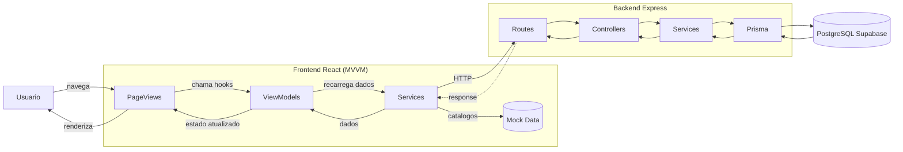

<div align="center">

# SafeAnchor — Frontend

**Interface em React 19 + Vite 7 para o MVP de apresentacao do SafeAnchor**


</div>

---

## Sobre

Interface do SafeAnchor: gestao de frotas, manutencao, inspecoes, checklists,
marinas e dashboard por persona. Arquitetura MVVM com ViewModels isolando a logica
de negocio da camada de apresentacao.

> Este README documenta **o que**, **como** e **por que**. As decisoes tecnicas ficam
> registradas para a fase oral — nao so "funciona", mas "funciona e eu sei explicar".

## Sumario

- [Arquitetura](#arquitetura)
- [Stack](#stack)
- [Estrutura de pastas](#estrutura-de-pastas)
- [Como rodar](#como-rodar)
- [Fluxo de dados](#fluxo-de-dados)
- [Modulos implementados](#modulos-implementados)
- [Sistema visual e loading](#sistema-visual-e-loading)
- [Decisoes tecnicas](#decisoes-tecnicas)
- [Deploy](#deploy)
- [Roadmap](#roadmap)

---

## Arquitetura

O frontend segue o padrao **MVVM (Model-View-ViewModel)**:

```mermaid
flowchart LR
    A[PageViews<br/>(views/)] -->|chama| B[use*ViewModel hooks<br/>(viewmodels/)]
    B -->|recarrega| C[Services<br/>(services/)]
    C -->|HTTP| D[(Backend API)]
    C -->|catalogos| E[(Mock Data)]
```

| Camada | Responsabilidade |
|---|---|
| `views/` | Paginas (PageViews) — composicao de componentes |
| `viewmodels/` | Hooks `use*` que encapsulam logica de negocio |
| `services/` | Camada de dados — API nos modulos core, mock nos catalogos |
| `components/` | Componentes compartilhados (AppShell, Formularios, Cards) |
| `context/` | React Context (autenticacao) |
| `router/` | AppRouter + AppShell (navegacao por persona) |

---

## Stack

- **React 19** — UI library
- **Vite 7** — dev server e build
- **react-router-dom v7** — roteamento SPA com basename dinamico
- **CSS puro com BEM** — um único `src/styles/global.css`, com tokens semânticos
- `fetch` nativo para comunicacao com a API (sem lib de requisicao)

---

## Estrutura de pastas

```text
apps/frontend/
├── public/
├── src/
│   ├── components/
│   │   ├── AppShell.jsx               # shell de navegacao por persona
│   │   ├── ProtectedRoute.jsx         # guard de autenticacao
│   │   ├── VesselForm.jsx             # formulario de embarcacoes
│   │   ├── MaintenanceForm.jsx        # formulario de manutencao
│   │   ├── ChecklistTemplateForm.jsx  # formulario de template
│   │   ├── ChecklistExecutionForm.jsx # formulario de execucao
│   │   ├── DocumentForm.jsx           # formulario de documento
│   │   ├── InspectionCard.jsx         # card de inspecao
│   │   ├── StatusBadge.jsx            # badge de status
│   │   ├── ReadinessGauge.jsx         # gauge de prontidao
│   │   ├── PageHeader.jsx             # cabecalho de pagina
│   │   ├── EmptyState.jsx             # estado vazio
│   │   ├── ErrorState.jsx             # erro com mensagem e ação
│   │   ├── Skeleton.jsx               # skeleton + região com aria-busy
│   │   ├── PageSkeletons.jsx          # skeletons por contexto de tela
│   │   ├── LoadingFallback.jsx        # fallback de telas secundárias
│   │   ├── SubmitButton.jsx           # submit com disabled/aria-busy/spinner
│   │   ├── InlineSpinner.jsx          # spinner decorativo de ação
│   │   ├── Icon.jsx                   # icones SVG
│   │   └── ...                        # outros componentes
│   ├── context/
│   │   └── AuthContext.jsx            # login/cadastro via API e sessao JWT
│   ├── mock/
│   │   ├── vessels.js                 # embarcacoes simuladas
│   │   ├── maintenances.js            # manutencoes simuladas
│   │   ├── inspections.js             # inspecoes simuladas
│   │   └── ...
│   ├── router/
│   │   ├── AppRouter.jsx              # rotas da aplicacao
│   │   └── AppShell.jsx               # shell com sidebar por persona
│   ├── services/
│   │   ├── api.js                     # fetch + token JWT (VITE_API_URL)
│   │   ├── authService.js             # register/login/me
│   │   ├── vesselService.js           # embarcacoes via API
│   │   ├── maintenanceService.js      # manutencao via API
│   │   ├── documentService.js         # documentos via API + status por validade
│   │   ├── inspectionService.js       # inspecoes via API + checklist padrao
│   │   ├── dashboardService.js        # prontidao calculada a partir da API
│   │   ├── checklistTemplateService.js
│   │   ├── checklistExecutionService.js
│   │   ├── maintenanceDashboardService.js
│   │   ├── moduleService.js           # modulos disponiveis
│   │   └── ...                        # catalogos ainda em mock
│   ├── viewmodels/
│   │   ├── useVesselsViewModel.js
│   │   ├── useCreateVesselViewModel.js
│   │   ├── useEditVesselViewModel.js
│   │   ├── useMaintenancesViewModel.js
│   │   ├── useMaintenanceDashboardViewModel.js
│   │   ├── useInspectionViewModel.js
│   │   ├── useCreateDocumentViewModel.js
│   │   ├── useChecklistTemplatesViewModel.js
│   │   ├── useChecklistExecutionViewModel.js
│   │   └── ...
│   ├── views/
│   │   ├── LoginPage.jsx
│   │   ├── RegisterPage.jsx
│   │   ├── DashboardPage.jsx
│   │   ├── FleetPage.jsx
│   │   ├── VesselDetailPage.jsx
│   │   ├── MaintenancePage.jsx
│   │   ├── DocumentsPage.jsx
│   │   ├── CreateDocumentPage.jsx
│   │   ├── InspectionsPage.jsx
│   │   ├── NewInspectionPage.jsx
│   │   ├── InspectionDetailPage.jsx
│   │   ├── ChecklistTemplatesPage.jsx
│   │   ├── MarinasPage.jsx
│   │   └── ...                       # 40+ paginas
│   ├── styles/
│   │   └── *.css                      # BEM global
│   ├── App.jsx
│   └── main.jsx                       # BrowserRouter com basename
├── vite.config.js                     # base via VITE_BASE_URL
└── package.json
```

---

## Como rodar

```bash
cd apps/frontend
npm install
cp .env.example .env   # VITE_API_URL=http://localhost:3001
npm run dev
```

Aplicacao em `http://localhost:5173`. **O backend precisa estar rodando** em
`http://localhost:3001` para autenticacao e dados reais.

```bash
npm run build    # build de producao
npm run preview  # previsualiza o build
```

> Nao ha script de lint neste projeto (sem ESLint configurado).

### Variaveis de build e privacidade

- `VITE_API_URL`: URL da API; no GitHub Pages vem da variavel de repositorio.
- `VITE_RESEARCH_WHATSAPP`: numero somente com digitos (`55` + DDD + numero).
  Quando preenchido, aparece o botao flutuante `WhatsAppButton` em todas as
  paginas e o link "Enviar por WhatsApp" na confirmacao da pesquisa.
- `VITE_RESEARCH_INBOX`: destino do link manual de e-mail na confirmacao.

A rota publica `/privacidade` traz a politica de privacidade/LGPD. O
`CookieNotice` avisa sobre o armazenamento local (sessao, rascunho da pesquisa e
o proprio aceite); nao ha cookies de rastreamento.

---

## Fluxo de dados



`use*ViewModel` concentra o estado (dados, loading, erro) e expoe funcoes
(`create`, `update`, `delete`). As PageViews apenas orquestram: decidem o que
renderizar e passam os dados adiante.

O `api.js` guarda o token JWT, envia `Authorization: Bearer <token>` e dispara o
evento `auth:unauthorized` em respostas 401; o `AuthContext` limpa a sessao. Como
`/auth/register` nao devolve token, o cadastro chama register e login em
sequencia para abrir a sessao.

---

## Modulos implementados

### Conectados ao backend real

| Modulo | Service | ViewModel | Status |
|---|---|---|---|
| Autenticacao | `authService.js` / `api.js` | `AuthContext` | Funcional |
| Embarcacoes | `vesselService.js` | `useVesselsViewModel` | Funcional |
| Manutencao | `maintenanceService.js` | `useMaintenancesViewModel` | Funcional |
| Dashboard manutencao | `maintenanceDashboardService.js` | `useMaintenanceDashboardViewModel` | Funcional |
| Manutencao preventiva | `preventiveMaintenanceService.js` | `usePreventiveMaintenanceViewModel` | Funcional |
| Checklist templates | `checklistTemplateService.js` | `useChecklistTemplatesViewModel` | Funcional |
| Checklist execucoes | `checklistExecutionService.js` | `useChecklistExecutionViewModel` | Funcional |
| Documentos | `documentService.js` | `useCreateDocumentViewModel` | Funcional (sem upload) |
| Inspecoes | `inspectionService.js` | `useInspectionViewModel` | Funcional |
| Dashboard | `dashboardService.js` | pagina `DashboardPage` | Dados reais; feed mock |

### Com dados mock (demonstracao)

| Modulo | Service | Status |
|---|---|---|
| Marinas | `marinaService.js` | Mock |
| Marketplace | `marketplaceService.js` | Mock |
| Comunidade | `communityService.js` | Mock |
| Eventos | `eventService.js` | Mock |
| Academy (treinamento) | `academyService.js` | Mock |
| Jobs & Crew | `jobsService.js` | Mock |
| Trip Planner | `tripService.js` | Mock |
| IA | `aiService.js` | Mock |

> `documentService.js` e `inspectionService.js` adaptam o formato da API ao
> formato esperado pelas views e calculam status/prontidao no cliente. A API nao
> fornece um campo `readiness`.

---

## Sistema visual e loading

O tema **Maritime Precision** vem da referência
`stitch_safeanchor_maritime_ux_architecture/` e vive em `src/styles/global.css`
como tokens: Light Mist `#F2F6F5`, Deep Ocean Navy `#102A43`, Abyss Teal
`#123C43`, Sea Teal `#167D83`, bordas hairline de 1 px e raio 4 px. Não há
Tailwind, lib de ícones ou lib de animação. O contrato completo está em
[`../../docs/visual-system.md`](../../docs/visual-system.md).

| Componente | Quando usar |
|---|---|
| `Skeleton` / `SkeletonRegion` | formas internas; a região avisa leitores de tela com `aria-busy` + `.sr-only` |
| `PageSkeletons` | dashboard, grid de embarcações, lista, tabela e detalhe — a mesma geometria da tela final |
| `LoadingFallback` | telas secundárias e validação de sessão (`ProtectedRoute`) |
| `ErrorState` | falha com explicação e botão de nova tentativa |
| `SubmitButton` | ações assíncronas: `disabled`, `aria-busy`, spinner e rótulo estável |

Regras que o próximo agente precisa preservar:

1. Skeleton só para layout conhecido (1–10 s). Botão/input/modal/toast não
   recebem skeleton — usam `SubmitButton`/`InlineSpinner`.
2. `ErrorState` e `EmptyState` encerram a espera com uma saída clara, nunca com
   parágrafo solto ou tela presa em "Carregando...".
3. Pulse do skeleton tem 2 ciclos finitos; `fade-in`, `survey-in` e
   `whatsapp-card-in` só rodam sob `prefers-reduced-motion: no-preference`.
4. `transition: all` foi banido: animar apenas `color`, `background-color`,
   `border-color`, `box-shadow`, `opacity` e `transform`.
5. Validação local: `npm.cmd run build` dentro de `apps/frontend` com
   `VITE_BASE_URL`, `VITE_API_URL` e `VITE_RESEARCH_WHATSAPP`.

---

## Decisoes tecnicas

- **MVVM em vez de tudo no componente.**
  As PageViews ficam limpas — so compoem e delegam. A logica de negocio vive
  nos ViewModels (`use*ViewModel`) e e reutilizavel entre paginas.

- **Services como adaptadores.**
  Catalogos ainda leem arquivos de mock, enquanto os modulos core chamam a API.
  `documentService` e `inspectionService` convertem o contrato do backend no
  formato que as views ja esperavam — nada nos ViewModels precisou mudar.

- **CSS BEM centralizado em `global.css`.**
  Como o projeto não usa módulos CSS nem Tailwind, todos os estilos ficam em um
  único arquivo organizado por seções e tokens semânticos. Isso facilita
  localizar uma classe por nome BEM e manter o tema consistente entre telas.

- **AppShell com navegacao por persona.**
  O `AppShell` renderiza itens de navegacao diferentes conforme a `persona` do
  usuario autenticado (`OWNER`, `SERVICE_PROVIDER`, `MARINA`), obtida do `/auth/me`.

- **VITE_BASE_URL para SPA no GitHub Pages.**
  O `base` do Vite e lido de `import.meta.env.VITE_BASE_URL`, setado no CI.
  O `BrowserRouter` usa `basename` dinamico para rotas corretas em subpath.

- **404.html como fallback.**
  O deploy no GitHub Pages copia `index.html` para `404.html` para que rotas
  do react-router funcionem direto na URL.

---

## Deploy

O frontend e deployado automaticamente via **GitHub Actions** no branch `main`:

1. `npm run build` (Vite)
2. Copia `dist/index.html` → `dist/404.html` (SPA fallback)
3. Deploy via `actions/upload-pages-artifact` + `actions/deploy-pages`

**URL:** https://luis-botelho.github.io/safeanchor-monorepo/

---

## Roadmap

- [x] Arquitetura MVVM com ViewModels
- [x] Navegacao por persona (AppShell)
- [x] Autenticacao real (login + cadastro + JWT via API)
- [x] Modulo de embarcacoes (CRUD via API + prontidao calculada)
- [x] Modulo de manutencao (agenda + dashboard via API)
- [x] Modulo de checklists (templates + execucoes via API)
- [x] Modulo de inspecoes via API (criacao, detalhe e checklist)
- [x] Modulo de documentos via API (cadastro, listagem e validade)
- [x] Dashboard com prontidao calculada a partir da API
- [x] Deploy no GitHub Pages
- [x] CI com build (sem lint configurado)
- [x] Tema Maritime Precision e skeletons com acessibilidade (em produção, PR #177)
- [ ] Conectar marinas ao backend
- [ ] Conectar marketplace ao backend
- [ ] Upload de arquivos de documentos
- [ ] Testes automatizados de componentes
- [ ] PWA para uso offline em campo
- [ ] Notificacoes em tempo real

---

<div align="center">

Desenvolvido por **Luis Botelho** · [GitHub](https://github.com/luis-botelho) · [LinkedIn](https://linkedin.com/in/luis-botelho)

</div>
